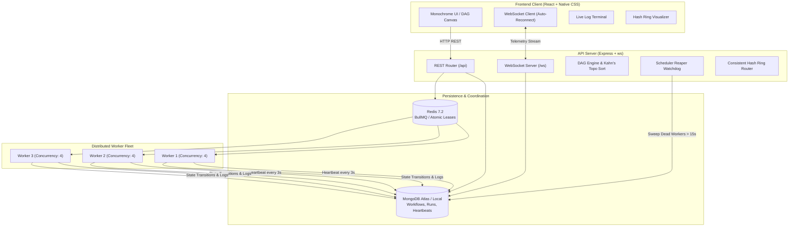

# FlowForge — Distributed Workflow Scheduling & Execution Platform

> A portfolio-grade, distributed workflow execution platform built from scratch in Node.js, React, Redis, and MongoDB to demonstrate advanced distributed systems architecture, graph algorithms (DAGs), real-time telemetry, and fault-tolerant worker coordination.

---

## Architecture Overview



---

## Key Technical Highlights

1. **Custom Graph Algorithms & DSA Engine**:
   - Implemented from scratch in plain JavaScript modules without third-party black-box DAG libraries.
   - Accompanied by side-by-side **C++ STL vs. JavaScript** algorithmic comparisons.
2. **Deterministic Task State Machine**:
   - Strict 7-state lifecycle: `BLOCKED` $\to$ `QUEUED` $\to$ `RUNNING` $\to$ `SUCCEEDED` / `RETRY_WAIT` / `FAILED` / `CANCELLED`.
   - Idempotent state transitions guarded by database lease updates.
3. **Distributed Worker Fleet & Fault Resilience**:
   - Multi-process worker pool decoupled from the HTTP API.
   - **Timeout Watchdog**: Promise-race abort controller on tasks exceeding `timeoutMs`.
   - **Reaper Watchdog**: Discovers dead workers (heartbeat expired $> 15\text{s}$) and atomically reclaims orphaned tasks.
4. **Real-Time Observability**:
   - Native `ws` WebSocket broadcast server with room subscriptions (`/ws?runId=...`).
   - 30-second ping/pong TCP heartbeat to detect silent network drops.
   - Snapshot healing upon client reconnection.
5. **Execution Analytics & Bottleneck Detection**:
   - Dynamic Programming critical path calculation in $O(V + E)$ time.
   - Calculates **Makespan**, **Sequential CPU Work**, and **Parallel Speedup Factor** ($S = \text{Sequential} / \text{Makespan}$).
   - Bottleneck task and edge highlighting on the SVG DAG canvas.
6. **Cluster Sharding & Consistent Hashing**:
   - 32-bit circular keyspace $[0, 2^{32}-1]$ with Virtual Nodes (Vnodes) and $O(\log K)$ Binary Search (`lower_bound`).
   - Side-by-side Rehash Avalanche Simulator proving only $\approx 1/N$ keys move on topology changes.
7. **Production Containerization & CI/CD**:
   - Multi-container `docker-compose.yml` (MongoDB, Redis, API, Worker, Nginx Client).
   - Automated GitHub Actions CI pipeline running 100 Jest tests and Vite builds.

---

## DSA Core: Algorithms Implemented & Big-O Analysis

| Algorithm | Implementation File | Time Complexity | Space Complexity | Distributed Systems Purpose |
|---|---|---|---|---|
| **Topological Sort** | [`server/src/algorithms/graph.js`](file:///d:/AI_ML/flowforge/server/src/algorithms/graph.js) | $O(V + E)$ | $O(V + E)$ | Kahn's Algorithm determines legal task execution order using indegree queues. |
| **Cycle Detection** | [`server/src/algorithms/graph.js`](file:///d:/AI_ML/flowforge/server/src/algorithms/graph.js) | $O(V + E)$ | $O(V)$ | DFS 3-Coloring (`WHITE`, `GRAY`, `BLACK`) rejects cyclical workflows with back-edges. |
| **Binary Max-Heap** | [`server/src/algorithms/heap.js`](file:///d:/AI_ML/flowforge/server/src/algorithms/heap.js) | $O(\log N)$ push/pop | $O(N)$ | Priority Queue with **Starvation Aging** ($+1$ priority every $5\text{s}$ in queue). |
| **Critical Path Analysis** | [`server/src/algorithms/criticalPath.js`](file:///d:/AI_ML/flowforge/server/src/algorithms/criticalPath.js) | $O(V + E)$ | $O(V)$ | Dynamic Programming DAG traversal to find longest path and minimum workflow makespan. |
| **Consistent Hash Ring** | [`server/src/algorithms/consistentHash.js`](file:///d:/AI_ML/flowforge/server/src/algorithms/consistentHash.js) | $O(\log(N \cdot V))$ lookup | $O(N \cdot V)$ | Maps workers and keys to $[0, 2^{32}-1]$ with virtual nodes to avoid rehash avalanches. |

---

## Algorithmic Deep Dive: C++ STL vs. JavaScript

### 1. Consistent Hashing: Clockwise Binary Search

#### C++ (`std::map<uint32_t, string>` Red-Black Tree)
```cpp
std::map<uint32_t, std::string> ring;

std::string getNode(const std::string& key) {
    if (ring.empty()) return "";
    uint32_t keyHash = hashFn(key);
    // O(log(N * V)) lower_bound on balanced binary search tree
    auto it = ring.lower_bound(keyHash);
    if (it == ring.end()) {
        it = ring.begin(); // Circular wraparound
    }
    return it->second;
}
```

#### JavaScript (`Sorted Array + Binary Search`)
```javascript
findLowerBoundIndex(targetHash) {
  if (this.ringKeys.length === 0) return -1;
  let low = 0, high = this.ringKeys.length - 1, res = -1;
  while (low <= high) {
    const mid = Math.floor((low + high) / 2);
    if (this.ringKeys[mid] >= targetHash) {
      res = mid;
      high = mid - 1; // Check left side for earlier match
    } else {
      low = mid + 1;
    }
  }
  return res === -1 ? 0 : res; // Circular wraparound
}
```

---

## Distributed Task State Machine

```
                   +------------------+
                   |     BLOCKED      |
                   +------------------+
                            | (Prerequisites SUCCEEDED)
                            v
                   +------------------+
                   |      QUEUED      |
                   +------------------+
                            | (Worker Lease Acquired)
                            v
                   +------------------+
                   |     RUNNING      |
                   +------------------+
                      /     |      \
        (Success)    /      |       \  (Error / Crash / Timeout)
                    v       |        v
     +-----------------+    |     +------------------+
     |    SUCCEEDED    |    |     |   RETRY_WAIT     |
     +-----------------+    |     +------------------+
                            |       | (Exponential Backoff Elapsed)
              (Cancelled)   |       v
                    v       |    (Back to QUEUED)
     +-----------------+    |
     |    CANCELLED    |    | (Retries Exhausted / Unrecoverable)
     +-----------------+    v
                   +------------------+
                   |      FAILED      |
                   +------------------+
```

---

## Senior Engineer Interview Defense Cheatsheet

### 1. Why does Kahn's algorithm run in $O(V + E)$ time?
- Computing indegrees inspects every vertex ($V$) and every directed edge ($E$) once.
- Every vertex enters and leaves the queue exactly once ($O(V)$).
- When a vertex is processed, we decrement indegrees for each of its outgoing edges ($O(E)$).
- Total time: $O(V + E)$ with $O(V)$ space for the indegree table.

### 2. What is Amdahl's Law in workflow execution?
- **Amdahl's Law**: The speedup of a program from parallelization is limited by the sequential fraction of the task.
- In a DAG, the **Critical Path** is the longest sequential bottleneck chain.
- If you optimize a task that is **not** on the critical path, the workflow's overall makespan (wall-clock completion time) **does not decrease by even 1 millisecond**. Only optimizing tasks on the critical path improves makespan!

### 3. Does Consistent Hashing eliminate the need for distributed locks or leases?
- **No.** Consistent hashing is an **affinity and routing heuristic**, not a distributed consensus protocol.
- Under network partitions or heartbeat delays (split-brain), two workers can observe different ring views and both believe they own the same key.
- Safe execution still strictly requires distributed leases with fencing tokens (Redis or database conditional updates).

### 4. How does the Reaper differentiate a slow task from a crashed worker?
- The worker process must continuously send a heartbeat every $3\text{s}$ (`lastHeartbeat = Date.now()`).
- If a task takes $60\text{s}$ but the worker is healthy, its heartbeat continues updating.
- The Reaper **only** reclaims tasks when the worker's heartbeat has been dead for longer than `leaseTimeoutMs` ($15\text{s}$).

---

## Quickstart Guide

### Option 1: Full-Stack Docker Compose (Recommended)
Boot the entire multi-container platform with one command:
```bash
# Clone the repository
git clone https://github.com/your-username/flowforge.git
cd flowforge

# Build and start all 5 services (mongo, redis, api, worker, client)
docker compose up --build -d

# Check cluster status
docker compose ps

# Access the monochrome web UI
open http://localhost:3000
```

### Option 2: Native Local Development
```bash
# 1. Start database dependencies
docker compose up mongodb redis -d

# 2. Start API Server (Terminal 1)
cd server
npm install
npm test      # Runs 100/100 unit & integration tests
npm run dev   # Starts API on http://localhost:5000

# 3. Start Distributed Background Worker (Terminal 2)
cd server
npm run worker

# 4. Start React Frontend (Terminal 3)
cd client
npm install
npm run dev   # Starts Vite dev server on http://localhost:5173
```

---

## Verification & Test Results

```bash
$ npm test

PASS tests/consistentHash.test.js
PASS tests/cluster.api.test.js
PASS tests/analytics.test.js
PASS tests/reaper.test.js
PASS tests/worker.test.js
PASS tests/websocket.test.js
PASS tests/workflow.api.test.js
PASS tests/run.api.test.js
PASS tests/executionEngine.test.js
PASS tests/algorithms.test.js
PASS tests/health.test.js
PASS tests/workflow.schema.test.js

Test Suites: 12 passed, 12 total
Tests:       100 passed, 100 total
Snapshots:   0 total
Time:        5.139 s
```

---

## Project Structure

```
flowforge/
├── .github/
│   └── workflows/
│       └── ci.yml                     # GitHub Actions CI pipeline
├── client/
│   ├── src/
│   │   ├── components/
│   │   │   ├── AnalyticsDashboard.jsx  # Makespan & Critical Path Gantt
│   │   │   ├── ChaosPanel.jsx          # Worker Failure Injection & Reaper
│   │   │   ├── ConsistentHashVisualizer.jsx # 360° Circular SVG Hash Ring
│   │   │   ├── GraphCanvas.jsx         # Custom SVG Directed Graph Canvas
│   │   │   ├── LogViewer.jsx           # Monochrome Live Terminal
│   │   │   ├── TaskModal.jsx           # Task CRUD & Dependencies
│   │   │   └── Header.jsx              # Status Badges
│   │   ├── hooks/
│   │   │   └── useWebSocket.js         # Auto-reconnecting WS Hook
│   │   ├── services/                   # Native Fetch API clients
│   │   └── styles/                     # Pure CSS design tokens
│   ├── nginx.conf                      # Production Reverse Proxy
│   └── Dockerfile                      # Multi-stage client build
├── server/
│   ├── src/
│   │   ├── algorithms/                 # DSA Core: TopoSort, Cycle, Heap, CP, HashRing
│   │   ├── controllers/                # REST Controllers
│   │   ├── middleware/                 # Error handling & validation
│   │   ├── models/                     # Mongoose Models (Workflow, Run, TaskRun, Worker)
│   │   ├── routes/                     # Express Routes
│   │   ├── scheduler/                  # State Machine, Reaper, Analytics, ClusterRing
│   │   ├── task-handlers/              # Simulation & Real Execution Handlers
│   │   ├── websocket/                  # Native ws streaming telemetry
│   │   └── workers/                    # Distributed Worker Process Pool
│   ├── tests/                          # 12 Jest & Supertest Suites (100 tests)
│   └── Dockerfile                      # Production server & worker container
├── docs/                               # 10 Module Technical Guides
└── docker-compose.yml                  # Full multi-container orchestration
```

---

## License
MIT
