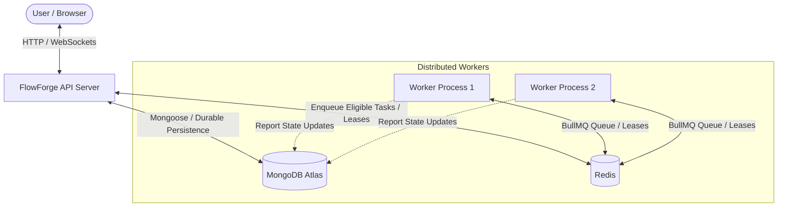

# FlowForge System Architecture

## 1. High-Level Overview

FlowForge is a distributed workflow scheduling and execution platform. It enables users to define complex directed acyclic graphs (DAGs) of interdependent tasks, schedule them with priority and resource awareness, execute them across distributed workers, and observe live status updates in real time.

---

## 2. Architectural Boundaries & Data Flow

### A. The Client (Monochrome UI)
- Built with **React** and standard modern CSS (strict monochrome palette: black, white, neutral grays).
- Communicates via:
  1. **REST API**: Workflow CRUD, triggering runs, inspecting history.
  2. **WebSocket Connection**: Real-time streaming of task state transitions, worker logs, and queue metrics.

### B. The API Server (Modular Monolith)
- Built with **Node.js** and **Express** (CommonJS).
- Serves API routes, validates schemas (Zod), and handles authentication/authorization.
- Decouples Express app configuration (`app.js`) from network binding (`server.js`) to allow fast, deterministic testing via Supertest.

### C. The Distributed Queue & Coordination Layer
- **Redis** backed by **BullMQ** handles distributed job dispatching, concurrency control, and ephemeral locks/leases.
- **MongoDB** provides durable persistence for workflow graphs, run execution records, task outputs, and audit logs.

### D. Worker Processes
- Independent Node.js processes that poll BullMQ for ready tasks.
- Execute allowlisted task handlers (simulation mode or real mode: HTTP, JSON/CSV transform, report generation).
- Send heartbeat updates and acquire execution leases to prevent duplicate or zombie runs.

---

## 3. Core Architectural Decisions (ADR Summary)

1. **Decoupled API & Workers**:
   - *Decision*: Separate HTTP request serving from heavy task execution.
   - *Rationale*: CPU-intensive or long-running tasks cannot block the Express event loop. Workers can scale horizontally based on queue depth.
2. **Dual-Store Architecture (MongoDB + Redis)**:
   - *Decision*: Redis for queue & coordination; MongoDB for durable state.
   - *Rationale*: Redis queue operations are atomic and sub-millisecond, but ephemeral. MongoDB provides rich querying, indexing, and durable audit logs.
3. **Strict Monochrome Design Tokens**:
   - *Decision*: CSS variables for neutral grayscale tones only.
   - *Rationale*: Creates a professional developer-tool aesthetic reminiscent of terminal tools and technical CAD workstations, eliminating SaaS design bloat.

